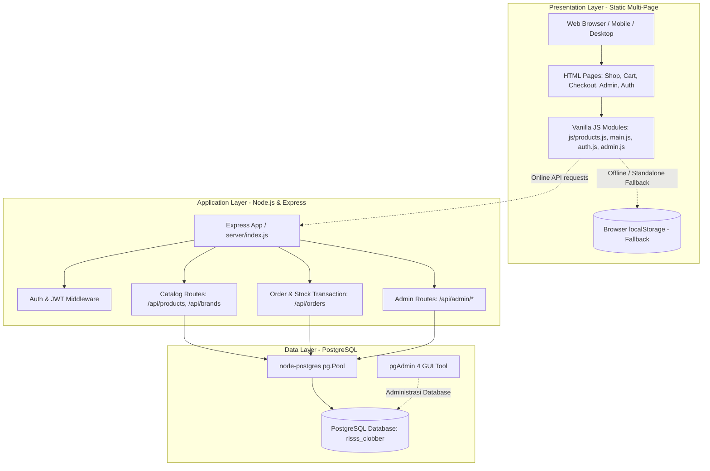
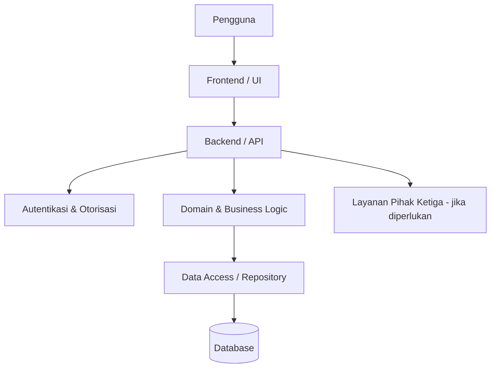

# Arsitektur Sistem — Risss.clobber

> **Status:** Backend REST API Node.js/Express (`server/`) dan PostgreSQL schema/seed (`sql/`) telah dibangun. Frontend multi-page beroperasi dalam mode hybrid: mengonsumsi API backend saat online, dan tetap memiliki fallback mandiri ke `js/products.js` & `localStorage` jika dijalankan murni static (misal VS Code Live Server).

## 1. Arsitektur Multi-Tier



## 2. Lapisan dan Tanggung Jawab

1. **Frontend (Browser):**
   - HTML5 semantik, CSS modern (`style.css`, `responsive.css`, `admin.css`).
   - Logika tampilan murni client-side, form validation, quick view modal, dan toast message.
   - Tidak pernah menyimpan kredensial database atau query SQL secara langsung.
2. **Backend REST API (`server/`):**
   - Runtime: Node.js (ES Modules).
   - Framework: Express.js dengan middleware CORS, cookie parser, dan centralized error handler.
   - Autentikasi: Password hashing menggunakan bcrypt, sesi menggunakan JWT via HttpOnly cookies dan Authorization Bearer token.
   - Transaksi Checkout: Menjamin integritas stok produk atomik dengan klausa SQL `FOR UPDATE` dan `ROLLBACK` jika stok habis.
3. **Database (`sql/` & pgAdmin 4):**
   - PostgreSQL 12+ dengan skema relasional di `sql/schema.sql` (12 tabel: brands, categories, users, user_addresses, products, product_sizes, orders, order_items, newsletter_subscribers, contact_inquiries, cart_items, wishlist_items).
   - pgAdmin 4 berfungsi murni sebagai antarmuka administratif untuk melihat table data, query console, import seed, dan monitoring performa query.


├── tech_stack.md
└── ui.ux.md
```

Struktur implementasi (misalnya `src`, `public`, `tests`, `migrations`, atau `infrastructure`) **belum ada** dan tidak boleh diasumsikan.

## 4. Baseline Arsitektur yang Perlu Diputuskan

Setelah jenis aplikasi dikonfirmasi, tim perlu menetapkan:

1. Batas frontend, backend, dan database.
2. Protokol komunikasi serta format API.
3. Lapisan validasi, service/domain, repository/data access, dan presentation.
4. Mekanisme session atau token.
5. Model data, migration, indexing, backup, dan retention.
6. Deployment, network boundary, secret management, log, metrics, dan tracing.

### Diagram Kandidat Setelah Keputusan Arsitektur

Diagram ini hanya template konseptual dan bukan implementasi aktual:



## 5. Alur Data yang Harus Diterapkan

Alur final perlu dikonfirmasi, tetapi kontrol minimum yang disyaratkan adalah:

1. Pengguna mengirim input melalui UI.
2. Client memeriksa validasi dasar untuk pengalaman pengguna; validasi server tetap wajib.
3. Backend mengautentikasi request dan memeriksa otorisasi berbasis peran/izin.
4. Layer domain menjalankan aturan bisnis.
5. Layer data mengakses database menggunakan query terparameterisasi atau ORM yang aman.
6. Backend mengembalikan response dengan format konsisten tanpa membocorkan rahasia.
7. Error dicatat pada log terstruktur dan pesan aman ditampilkan kepada pengguna.

## 6. Autentikasi, Otorisasi, dan Keamanan

- Implementasi autentikasi: **Belum tersedia**.
- Implementasi RBAC/permission: **Belum tersedia**.
- Kredensial dan secret: belum dikonfigurasi.
- HTTPS, rate limiting, CSRF protection, security headers, input validation, dan audit log harus dirancang sebelum production.
- Password tidak boleh disimpan dalam bentuk plaintext; gunakan hashing adaptif yang direkomendasikan stack final.

## 7. Error Handling dan Validasi

Belum ada error handler aktual. Baseline yang harus dipenuhi:

- Validasi input di boundary dan server.
- Response error memiliki format konsisten, kode HTTP yang tepat, dan correlation/request ID bila tersedia.
- Detail stack trace hanya boleh masuk ke log internal pada environment non-production yang aman.
- Error database dan layanan eksternal harus ditangani dengan timeout serta retry yang memiliki batas.

## 8. Integrasi Eksternal

Tidak ditemukan konfigurasi atau pemanggilan layanan pihak ketiga. Integrasi, credential, kontrak API, timeout, retry, dan fallback **Perlu dikonfirmasi** bila kebutuhan bisnis sudah ditetapkan.

