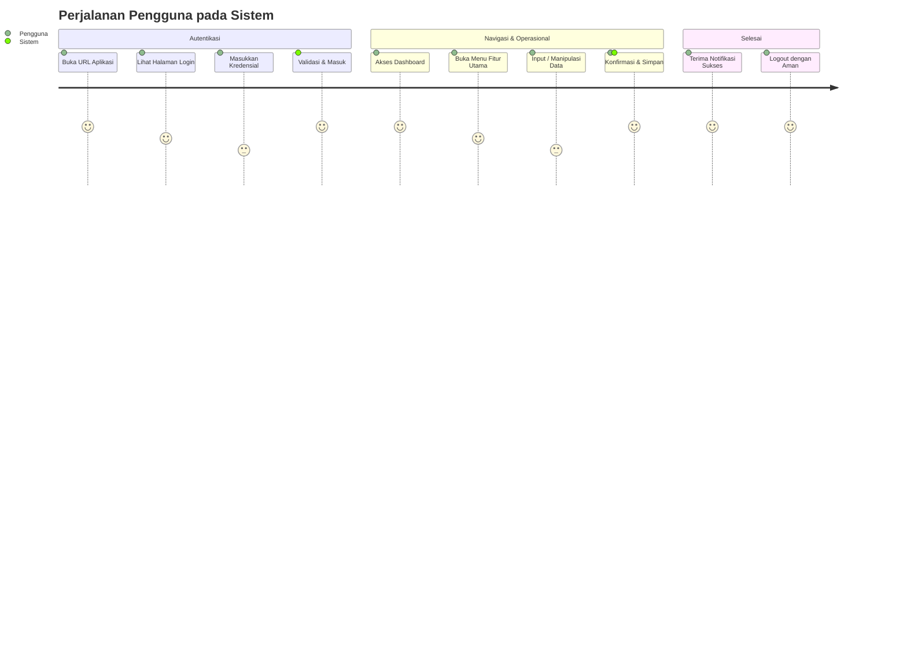

# UI/UX Guidelines — Risss.clobber

> **Status Dokumen:** Design System & Component Guidelines  
> **Status Implementasi:** Terimplementasi Penuh di `css/style.css`  
> **Tema:** Minimalis, Premium Streetwear & Terracewear Risss.clobber  

---

## 1. Filosofi Desain & Karakter Visual

- **Estetika:** Monokromatik maskulin, tegas, utilitarian, dan modern dengan aksen *olive green*.
- **Whitespace & Layout:** Ruang negatif yang lapang, grid bersih 4-kolom desktop / 2-kolom mobile.
- **Tone of Voice:** Singkat, lugas, mengutamakan visual produk dan keterbacaan tipografi.

---

## 2. Palet Warna (Color System)

| Token CSS | Hex Code | Penggunaan |
| :--- | :--- | :--- |
| `--bg` | `#0c0d0e` | Latar belakang utama (Deep Charcoal / Black) |
| `--surface` | `#131416` | Latar navbar, footer, kartu produk, form panel |
| `--card` | `#1a1c1e` | Latar thumbnail, modal inner, dropdown |
| `--card-border` | `#272a2e` | Garis pembatas halus, outline input, garis pemisah |
| `--text` | `#f3f4f6` | Teks heading, harga, isi utama |
| `--muted` | `#9ca3af` | Eyebrow label, deskripsi sekunder, placeholder |
| `--accent` | `#3d5240` | Announcement bar, aksen olive green premium |
| `--accent-light` | `#526d56` | Hover state olive, fokus form input |
| `--sale` | `#dc2626` | Badge diskon / sale |

---

## 3. Tipografi

- **Font Family:** `-apple-system, BlinkMacSystemFont, "Segoe UI", Roboto, Helvetica, Arial, sans-serif`
- **Heading:** Uppercase, tracking lebar (`letter-spacing: 1-3px`), bobot 800/900.
- **Eyebrow:** Ukuran `0.75rem`, uppercase, tracking `2px`, warna `--muted`.
- **Body & Harga:** Skala proporsional dengan format mata uang Rupiah `Intl.NumberFormat('id-ID')`.

---

## 4. Komponen Antarmuka Terstandarisasi

- **Navbar Sticky:** Backdrop blur, logo Risss.clobber, menu navigasi, counter badge cart & wishlist, tombol menu responsif mobile.
- **Product Card:** Aspect-ratio 3/4, zoom halus gambar saat hover (`scale(1.04)`), badge New/Sale, tombol Wishlist mengambang, Quick View trigger.
- **Size Selector:** Pill button interaktif dengan state aktif dan validasi peringatan jika belum dipilih.
- **Quantity Stepper:** Tombol `+` dan `-` dengan batas stok minimal 1 dan maksimal stok produk.
- **Toast Notification:** Feedback melayang di sudut kanan bawah setiap kali aksi user berhasil dieksekusi.
- **Order Summary:** Rincian subtotal, kupon promo aktif, ongkos kirim kalkulatif, dan label disclaimer simulasi.

---

# UI/UX Guidelines

> **Status Dokumen:** Baseline Pedoman Desain  
> **Status Implementasi:** Belum Diimplementasikan (Belum ada komponen antarmuka atau styling pada workspace)  
> **Lokasi Repositori:** `C:\Users\LENOVO\Documents\standarDev`  
> **Tanggal Analisis:** 20 Oktober 2026  

---

## 1. Ringkasan Status Desain Antarmuka

Berdasarkan audit proyek, belum ditemukan berkas HTML, CSS, template engine, maupun komponen frontend (seperti React, Vue, Blade, atau sejenisnya).  
Oleh karena itu:
- Seluruh spesifikasi halaman, komponen visual, dan tata letak berstatus **Belum diimplementasikan**.
- Dokumen ini menetapkan *Design Baseline & System Tokens* acuan yang wajib dipatuhi pengembang saat tahap implementasi UI dimulai guna menjaga konsistensi.

---

## 2. Konsep dan Prinsip Desain Antarmuka

1. **Kejelasan (*Clarity*):** Elemen antarmuka harus langsung dipahami fungsinya tanpa ambiguitas visual.
2. **Konsistensi (*Consistency*):** Penggunaan warna status, bentuk tombol, penamaan label, dan spasi (*spacing*) seragam di setiap halaman.
3. **Umpan Balik Responsif (*Feedback*):** Setiap interaksi (klik tombol, pengiriman formulir, proses asinkron) wajib memberikan indikasi visual (loading spinner, pesan sukses/gagal).
4. **Efisiensi & Skalabilitas:** Mengutamakan hierarki informasi yang memudahkan pengguna menyelesaikan tugas dengan jumlah langkah minimal.
5. **Mobile-First & Adaptif:** Tata letak dirancang responsif dari layar terkecil (ponsel pintar) hingga desktop resolusi tinggi.

---

## 3. Target Pengguna dan Kebutuhan UI/UX

| Kelompok Pengguna | Karakteristik Perangkat | Kebutuhan Utama Desain | Status |
| :--- | :--- | :--- | :--- |
| **Pengguna Operasional / Umum** | Desktop & Ponsel Pintar | Alur navigasi sederhana, waktu muat cepat, formulir dengan validasi instan yang jelas. | *Perlu dikonfirmasi* |
| **Administrator / Manajemen** | Monitor Desktop / Laptop | Tata letak data berbasis tabel terstruktur, fitur pencarian/filter cepat, dan dashboard analitik ringkas. | *Perlu dikonfirmasi* |

---

## 4. Alur Perjalanan Pengguna (User Journey)

Alur umum interaksi pengguna yang direkomendasikan untuk implementasi fitur dasar:



---

## 5. Daftar Halaman dan Fungsi

Seluruh halaman berikut merupakan rekomendasi modular yang berstatus **Belum diimplementasikan**:

| Nama Halaman | Rute Rencana | Fungsi Halaman | Status Implementasi |
| :--- | :--- | :--- | :--- |
| **Halaman Login** | `/login` | Otentikasi identitas pengguna dengan proteksi brute-force. | *Belum diimplementasikan* |
| **Halaman Registrasi** | `/register` | Pendaftaran akun baru (*jika diizinkan secara publik*). | *Perlu dikonfirmasi* |
| **Dashboard Utama** | `/dashboard` | Ringkasan metrik operasional dan pintasan menu utama. | *Belum diimplementasikan* |
| **Daftar Entitas Data** | `/items` | Tampilan tabel data master/transaksi dengan filter & pagination. | *Belum diimplementasikan* |
| **Formulir Input/Edit** | `/items/new`, `/items/:id/edit` | Form manipulasi data dengan validasi *inline* sisi client & server. | *Belum diimplementasikan* |
| **Halaman Error (404/500)** | Fallback rute | Menampilkan pesan kendala ramah pengguna dengan tombol kembali. | *Belum diimplementasikan* |

---

## 6. Wireframe Dasar (Konseptual)

```text
+--------------------------------------------------+
| Logo / Nama Aplikasi       Navigasi   Profil     |
+--------------------------------------------------+
| Breadcrumb / Judul Halaman                       |
|                                                  |
| [Ringkasan] [Ringkasan] [Ringkasan]              |
|                                                  |
| Filter [________] [Cari] [Tambah Data]           |
| +----------------------------------------------+ |
| | Kolom 1 | Kolom 2 | Status | Aksi            | |
| | Data    | Data    | Aktif  | Lihat/Edit      | |
| +----------------------------------------------+ |
+--------------------------------------------------+
```

Wireframe ini adalah acuan konseptual, bukan bukti bahwa layout tersebut sudah ada di proyek.

## 7. Design System Baseline

### 7.1 Warna

| Token | Nilai Rekomendasi | Penggunaan |
|---|---|---|
| Primary | `#2563EB` | Aksi utama, link, fokus |
| Primary dark | `#1D4ED8` | Hover/active |
| Surface | `#FFFFFF` | Kartu dan area konten |
| Background | `#F8FAFC` | Latar aplikasi |
| Text | `#0F172A` | Teks utama |
| Muted | `#64748B` | Teks sekunder |
| Success | `#16A34A` | Status berhasil |
| Warning | `#D97706` | Peringatan |
| Danger | `#DC2626` | Error/destructive |

Nilai di atas merupakan rekomendasi baru dan harus divalidasi dengan brand guideline. Teks normal wajib memenuhi kontras WCAG AA (minimal 4,5:1); teks besar minimal 3:1.

### 7.2 Tipografi dan Spasi

- Gunakan satu keluarga sans-serif yang tersedia secara aman, misalnya system font; pilihan final **Perlu dikonfirmasi**.
- Hierarki minimum: heading halaman, heading section, body, caption.
- Gunakan skala spasi konsisten berbasis kelipatan 4 atau 8 piksel.
- Hindari teks terlalu rapat; line-height body direkomendasikan sekitar 1,5.

### 7.3 Komponen

- **Tombol:** label berupa kata kerja jelas; bedakan primary, secondary, dan destructive; tampilkan state hover, focus, disabled, dan loading.
- **Formulir:** setiap kontrol memiliki label terlihat, helper text bila diperlukan, validasi dekat input, dan ringkasan error.
- **Tabel:** sediakan heading kolom, status yang tidak hanya dibedakan dengan warna, empty state, pagination jika data banyak, dan responsivitas.
- **Notifikasi:** gunakan pesan sukses/gagal yang dapat dipahami; jangan membocorkan detail teknis atau data sensitif.
- **Gambar:** gunakan `alt` deskriptif untuk gambar informatif dan `alt=""` untuk dekorasi.

## 8. Responsivitas

| Breakpoint | Aturan Baseline |
|---|---|
| Ponsel (320–767px) | Satu kolom, menu adaptif, kontrol sentuh minimal 44×44px, tabel dapat di-scroll secara terkontrol. |
| Tablet (768–1023px) | Grid dua kolom bila terbaca, sidebar dapat diciutkan, modal tidak memenuhi layar tanpa alasan. |
| Desktop (≥1024px) | Maksimalkan hierarki konten, sidebar/tabel lebih lebar, tetap gunakan max-width agar baris tidak terlalu panjang. |

## 9. Aksesibilitas

- Semua input memiliki label yang terkait secara programatik.
- Urutan fokus keyboard mengikuti urutan visual dan selalu memiliki indikator fokus terlihat.
- Semua fungsi tersedia tanpa mouse; tombol menggunakan elemen semantik, bukan `div` clickable.
- Jangan menyampaikan informasi hanya melalui warna; sertakan ikon/teks/status.
- Sediakan skip link, heading terstruktur, judul halaman informatif, dan fokus yang tidak terperangkap.
- Hargai `prefers-reduced-motion`; hindari animasi yang berpotensi mengganggu.
- Pastikan kontras, teks alternatif, dan struktur semantik diverifikasi dengan audit aksesibilitas.

## 10. Hal yang Perlu Dikonfirmasi

Brand, logo, warna resmi, font, daftar halaman aktual, persona, dan alur bisnis belum tersedia pada proyek. Semua keputusan tersebut harus disepakati sebelum implementasi UI.

